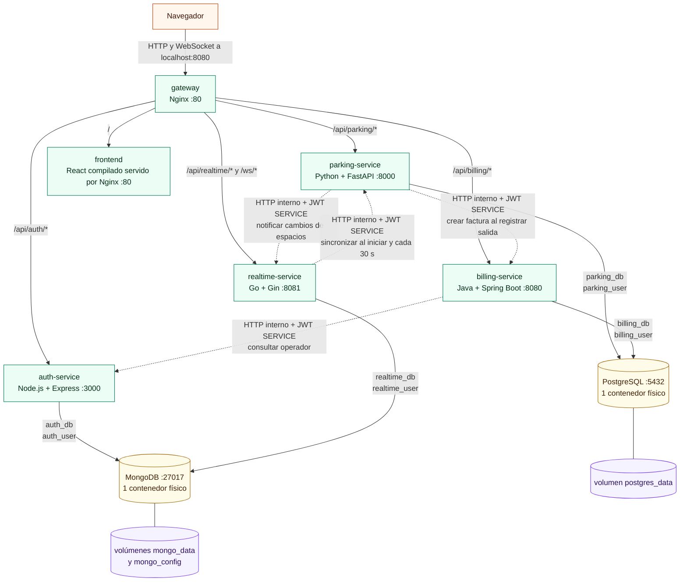

# Sistema de Parqueadero Inteligente

**Materia:** Lenguajes de Programación
**Proyecto:** Proyecto Final
**Estudiante:** Alejandro Carreño C.I. 27728674

## 1. Descripción del sistema

El sistema gestiona la operación de un parqueadero: registro de entradas y salidas de vehículos, asignación de espacios, cálculo de tarifas, facturación, reportes de ingresos y un mapa de ocupación que se actualiza en vivo.

Los espacios son independientes del tipo de vehículo mientras están libres. El tipo se registra de forma temporal al registrar una entrada y se elimina al liberar el espacio. Las tarifas son configurables y pueden incluir tipos de vehículo personalizados.

La solución se divide en cuatro microservicios, cada uno con su propio lenguaje y su propia base de datos lógica, detrás de un API Gateway Nginx que es la única puerta de entrada para la aplicación. El frontend es una aplicación React que consume los servicios a través del gateway.

| Componente | Tecnología | Responsabilidad | Base de datos |
|---|---|---|---|
| `auth-service` (`servicio-node`) | Node.js + Express | Usuarios, roles, login y emisión de JWT | MongoDB `auth_db` |
| `parking-service` (`servicio-python`) | Python + FastAPI | Espacios, tarifas, entradas, salidas y tickets | PostgreSQL `parking_db` |
| `billing-service` (`servicio-java`) | Java 21 + Spring Boot 3.5 | Facturación y reportes | PostgreSQL `billing_db` |
| `realtime-service` (`servicio-go`) | Go + Gin | WebSocket, estado en vivo del mapa, historial de eventos | MongoDB `realtime_db` |
| `gateway` (`nginx`) | Nginx | Punto de entrada único, enrutamiento y rate limit | — |
| `frontend` | React + Vite + Tailwind | Interfaz en español | — |

## 2. Diagrama de arquitectura



La red interna `parking-net` conecta todos los contenedores. El gateway publica la aplicación en el host mediante `GATEWAY_PORT` (`8080` por defecto). Los cuatro backends y las bases de datos no publican puertos propios al host.

Las líneas continuas representan tráfico del navegador hacia el gateway y enrutamiento del gateway hacia los servicios. Las líneas punteadas representan llamadas HTTP internas autenticadas con JWT de servicio. Las líneas hacia las bases de datos representan persistencia directa: ningún microservicio accede a la base lógica de otro. PostgreSQL y MongoDB son contenedores físicos únicos, cada uno con dos bases lógicas y credenciales separadas.

## 3. Microservicios

Los errores de negocio y validación de la API usan el formato común:

```json
{ "error": "PLATE_ALREADY_PARKED", "message": "The vehicle already has an open ticket" }
```

Las respuestas de salud y algunas respuestas generadas directamente por Nginx pueden usar un formato diferente.

### 3.1 auth-service (Express, puerto 3000)

| Método | Ruta | Acceso | Descripción |
|---|---|---|---|
| POST | `/api/auth/login` | público | Valida credenciales y devuelve `{ token, user }` |
| GET | `/api/auth/me` | autenticado | Perfil del token actual |
| POST | `/api/auth/users` | ADMIN | Crea usuario |
| GET | `/api/auth/users` | ADMIN | Lista usuarios |
| GET | `/api/auth/users/:id` | ADMIN | Detalle |
| PUT | `/api/auth/users/:id` | ADMIN | Actualiza nombre, rol, estado o clave |
| DELETE | `/api/auth/users/:id` | ADMIN | Desactiva el usuario |
| GET | `/internal/users/:id` | SERVICE | Datos del operador para facturación |
| GET | `/health` | público | Estado |

### 3.2 parking-service (FastAPI, puerto 8000)

Documentación Swagger en `/api/parking/docs`.

| Método | Ruta | Acceso | Descripción |
|---|---|---|---|
| GET | `/api/parking/spaces` | autenticado | Lista de espacios (filtros `status`, `vehicleType`) |
| POST | `/api/parking/spaces` | ADMIN | Crea espacio |
| PUT | `/api/parking/spaces/{id}` | ADMIN | Edita espacio |
| DELETE | `/api/parking/spaces/{id}` | ADMIN | Elimina si no tiene ticket abierto |
| GET | `/api/parking/rates` | autenticado | Tarifas por tipo de vehículo |
| POST | `/api/parking/rates` | ADMIN | Crea una tarifa para un tipo de vehículo nuevo |
| PUT | `/api/parking/rates/{vehicleType}` | ADMIN | Actualiza tarifa |
| POST | `/api/parking/entries` | autenticado | Registra entrada y asigna espacio |
| GET | `/api/parking/tickets` | autenticado | Lista de tickets (filtros `status`, `plate`) |
| GET | `/api/parking/tickets/{id}` | autenticado | Detalle |
| GET | `/api/parking/tickets/{id}/quote` | autenticado | Cotiza el monto sin cerrar el ticket |
| POST | `/api/parking/exits` | autenticado | Registra salida, factura y libera el espacio |
| GET | `/internal/parking/spaces` | SERVICE | Estado completo para la resincronización de Go |
| GET | `/health` | público | Estado |

### 3.3 billing-service (Spring Boot, puerto 8080)

| Método | Ruta | Acceso | Descripción |
|---|---|---|---|
| GET | `/api/billing/invoices` | ADMIN, OPERATOR | Lista paginada (`page`, `size`, `plate`, `from`, `to`) |
| GET | `/api/billing/invoices/{id}` | ADMIN, OPERATOR | Detalle |
| GET | `/api/billing/reports/summary` | ADMIN | Totales del día y del mes |
| GET | `/api/billing/reports/daily` | ADMIN | Ingresos por día |
| GET | `/api/billing/reports/by-vehicle-type` | ADMIN | Ingresos por tipo de vehículo |
| GET | `/api/billing/reports/by-operator` | ADMIN | Ingresos por operador |
| POST | `/internal/billing/invoices` | SERVICE | Crea la factura (idempotente por `ticketId`) |
| GET | `/health` | público | Estado |

### 3.4 realtime-service (Go + Gin, puerto 8081)

| Método | Ruta | Acceso | Descripción |
|---|---|---|---|
| GET | `/ws/spaces` | primer mensaje `auth` | WebSocket del mapa |
| GET | `/api/realtime/spaces` | autenticado | Estado actual de los espacios |
| GET | `/api/realtime/occupancy` | autenticado | Ocupación actual y serie histórica (`?minutes=60`) |
| GET | `/api/realtime/events` | autenticado | Últimos eventos (`?limit=50`) |
| POST | `/internal/realtime/events` | SERVICE | Recibe un cambio de espacio |
| GET | `/health` | público | Estado |

Protocolo WebSocket: el cliente envía `{"type":"auth","token":"<jwt>"}` en los primeros 5 segundos; el servidor responde con `snapshot`, y luego emite `space_update` y `occupancy` en cada cambio. Si la autenticación falla, cierra con el código `4401`.

Los endpoints `/health` de los servicios se usan para los healthchecks internos de Compose y no se publican mediante el gateway.

## 4. Modelo de datos

### PostgreSQL — `parking_db`

| Tabla | Columnas principales |
|---|---|
| `parking_spaces` | `id`, `code` (único), `zone`, `row_index`, `col_index`, `vehicle_type` (nullable y temporal), `status`, `status_since` |
| `rates` | `id`, `vehicle_type` (único), `first_hour`, `extra_hour`, `daily_cap`, `grace_minutes` |
| `tickets` | `id` (uuid), `plate`, `vehicle_type`, `space_id`, `entry_at`, `exit_at`, `total_minutes`, `fee`, `status`, `operator_id`, `invoice_number` |

Dos índices únicos parciales sobre `tickets` (una sola fila `OPEN` por placa y por espacio) protegen contra condiciones de carrera.

### PostgreSQL — `billing_db`

| Tabla | Columnas principales |
|---|---|
| `invoices` | `id`, `number` (único), `ticket_id` (único), `plate`, `vehicle_type`, `entry_at`, `exit_at`, `total_minutes`, `subtotal`, `tax`, `total`, `operator_id`, `operator_name`, `created_at` |

### MongoDB — `auth_db`

Colección `users`: `username` (índice único), `passwordHash` (bcrypt), `fullName`, `role`, `active`, `createdAt`, `updatedAt`.

### MongoDB — `realtime_db`

- `space_events`: `type`, `spaceId`, `spaceCode`, `status`, `plate`, `vehicleType`, `statusSince`, `occurredAt` (índice descendente).
- `occupancy_snapshots`: `capturedAt`, `total`, `occupied`, `free`, `maintenance` (el servicio intenta guardar un snapshot cada minuto cuando ya tiene espacios sincronizados).

Cada base tiene su propio usuario, sin acceso a las demás.

Los espacios libres y en mantenimiento no tienen un tipo de vehículo asociado. `status_since` se registra para espacios ocupados y en mantenimiento, y se reinicia al liberar un espacio; para espacios ocupados también se muestran la placa y la hora de entrada.

## 5. Instrucciones para ejecutar

Requisitos: Docker Desktop con al menos 4 GB de RAM asignados.

```bash
git clone <URL_DEL_REPOSITORIO>
cd parking-system
cp .env.example .env
docker compose up --build
```

El archivo `.env` es opcional: el `docker-compose.yml` incluye valores por defecto de demostración, por lo que el sistema también levanta sin él.

- Aplicación: `http://localhost:8080`
- Usuario inicial: `admin` / `Admin123!`
- Puerto del host configurable con `GATEWAY_PORT` en `.env`.

En el formulario de operación se puede seleccionar un espacio libre desde la lista o abrirlo directamente desde el mapa del dashboard. En este último caso el espacio queda preseleccionado y cambiar el tipo de vehículo no lo deselecciona.

Para reiniciar las bases de datos desde cero (los scripts de inicialización solo corren con el volumen vacío):

```bash
docker compose down -v
docker compose up --build
```

## 6. Capturas de pantalla

Las evidencias capturadas durante la validación están en `docs/screenshots/`:

- [Inicio de sesión](docs/screenshots/login.png).
- [Inicio del administrador](docs/screenshots/inicio-admin.png) y [del operador](docs/screenshots/inicio-operador.png), con mapa y eventos en vivo.
- [Operación con cotización de salida](docs/screenshots/operacion-cotizacion.png).
- [Facturas](docs/screenshots/facturas.png).
- [Reportes](docs/screenshots/reportes.png).
- [Swagger de `parking-service`](docs/screenshots/swagger-parking.png).

La salida vigente de `docker compose ps` se valida en la sección de ejecución; captura de terminal y URL del repositorio deben agregarse al publicar la entrega.

## 7. Flujo entrada → salida → factura

```
Frontend -> Gateway -> parking : POST /api/parking/exits (JWT de usuario)
parking : calcula minutos y tarifa
parking -> billing : POST /internal/billing/invoices (JWT de servicio)
billing -> auth    : GET /internal/users/{operatorId} (JWT de servicio)
billing : guarda la factura en billing_db y responde el número
parking : cierra el ticket y libera el espacio en parking_db
parking -> realtime : POST /internal/realtime/events (JWT de servicio)
realtime : actualiza el estado, guarda el evento y difunde por WebSocket
Frontend : recibe space_update y repinta el mapa
```

Si `billing-service` falla, la salida responde `502` y el ticket permanece abierto; reintentar es seguro porque la facturación es idempotente por `ticketId`. Si `realtime-service` falla, el negocio continúa y el servicio se resincroniza solo al volver.

## 8. Seguridad

- **JWT de usuario:** emitido por `auth-service` (HS256, 8 h). Los cuatro servicios lo validan con el mismo `JWT_SECRET`.
- **JWT de servicio:** vida de 60 s y rol `SERVICE`; es el único acceso a las rutas `/internal/**`, que además Nginx bloquea con `404`.
- **Contraseñas:** almacenadas como hash bcrypt (costo 10); nunca se guardan ni se devuelven en claro.
- **Roles:** `ADMIN` administra usuarios, espacios, tarifas y reportes; `OPERATOR` registra entradas y salidas y consulta tickets y facturas.
- **Gateway:** rate limit en el login, cabeceras de seguridad y cuerpo máximo de 1 MB.
- **Tipos de vehículo:** la interfaz los obtiene de las tarifas configuradas y el administrador puede registrar tipos adicionales sin modificar el esquema de espacios. La API normaliza el tipo recibido al registrar una entrada, pero la tarifa se valida al cotizar o cerrar el ticket.

## 9. Decisiones técnicas resumidas

- Un contenedor PostgreSQL y uno MongoDB, con dos bases cada uno y un usuario por base.
- Las rutas son idénticas en el navegador, el gateway y los servicios (sin reescritura), y todo comparte origen, por lo que no se necesita CORS.
- Esquema de PostgreSQL creado al arrancar (`create_all` y `ddl-auto: update`) con reintentos de conexión.
- Mapa en Leaflet con `L.CRS.Simple`, sin dependencia de internet.
- Importes con `Decimal`, `BigDecimal` y `numeric(10,2)`; fechas en UTC.
- Los cambios de estado de los espacios incluyen `statusSince` y se propagan al mapa mediante WebSocket.

## 10. Limitaciones conocidas

- El token se guarda en `localStorage`; una cookie `HttpOnly` con protección CSRF sería más robusta.
- Desactivar un usuario no revoca los JWT ya emitidos; esos tokens pueden seguir funcionando hasta su expiración, que es de 8 horas por defecto.
- El WebSocket autentica el token enviado en el primer mensaje, pero actualmente acepta cualquier origen (`Origin`).
- Secreto compartido HS256; en producción se recomienda RS256 con llaves asimétricas.
- Sin migraciones versionadas ni pruebas automatizadas.
- Los servicios se comunican por HTTP síncrono; un broker de mensajes desacoplaría mejor parking, billing y realtime.
- Los valores por defecto del compose son solo de demostración.
